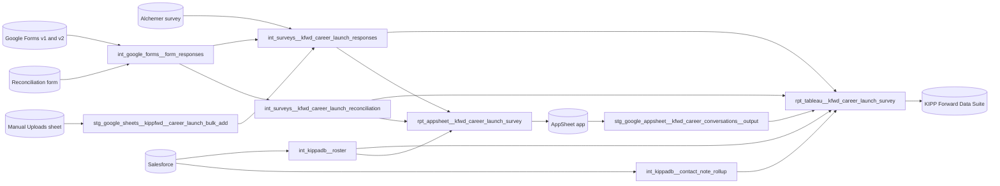

# KIPP Forward Career Launch Data Model

## What it is

The Career Launch survey tracks how KIPP Forward (KFwd) alumni do after they
finish high school, college, or a career and technical program. KFwd uses it to
judge whether each alum had a **Strong Launch**: a job that pays enough, with
benefits where the survey asked about them, or a place in graduate school. The
KFwd team and the board read the results by cohort. Counselors use the same data
one alum at a time, to see who has answered and who needs follow-up.

The data team owns the models, with Anthony Walters (Associate Director of Data)
as owner. Casey Gibson (Systems Analyst) is taking them over. The KFwd Career
Team owns the survey, the Strong Launch rule, and reconciliation.

Not every alum answers. The earliest responses date from 2022, so earlier
cohorts are thin. Survey waves go out after the December and May graduation
periods, and alumni can also answer between waves.

The family has 2 consumers:

- the Career Launch views in the KIPP Forward Data Suite Tableau workbook, which
  read `rpt_tableau__kfwd_career_launch_survey`;
- the Career Conversation Tracker AppSheet app, which reads
  `rpt_appsheet__kfwd_career_launch_survey` and writes counselors' checklist
  entries back to BigQuery.

## How it fits together



## Terms

- **Strong Launch** — the Tableau result for an alum's current response: Strong
  Launch, Part-Quality Job, Not Strong Launch, or No Survey. Tableau computes
  it; no dbt column holds it. See _Strong Launch rule_.
- **Part-Quality Job** — a job that clears the pay bar for the alum's degree but
  misses the Strong Launch bar.
- **The alum's degree** — `pursuing_degree_type` on the alum's earliest
  graduated postsecondary enrollment, by end date. An alum who earned an
  Associate's and later a Bachelor's is judged against the Associate's bar. The
  AppSheet app shows the latest enrollment instead, so the 2 can differ.
- **Survey source** — where a response came from, in `survey_title`:
  `Alchemer survey`, `Google Form v1`, `Google Form v2`, or `Bulk Add`.
- **Manual Upload** (`Bulk Add`) — one alum's answers that a counselor entered
  on a sheet, for an alum who told a counselor but did not fill in the survey.
- **Unmatched response** — a survey response that matches no alum in Salesforce,
  usually because the respondent used an email Salesforce does not have.
- **Reconciliation** — the Career Team's decision on an unmatched response:
  `Reconcile` links it to a Salesforce contact, and `Exclude` drops it. Older
  submissions have no decision; they still link the response to the contact they
  name, the same as `Reconcile`.
- **Current response** — the one response per alum that the dashboard counts,
  marked `rn_respondent = 1`.
- **HSG / TAF** — alumni groups that `int_kippadb__roster` derives from
  Salesforce and the student information system. HSG is a KIPP high school
  graduate: Salesforce says so, or the student left a KIPP high school with a
  graduation exit code. TAF is a KIPP middle school graduate who did not
  graduate from a KIPP high school and is not currently a high school student.
- **Career Conversation (CC1 to CC5)** — the numbered career conversations
  counselors log as Salesforce contact notes.
- **Career Conversation checklist** — 7 items a counselor checks off in the
  AppSheet app: résumé, LinkedIn, mock interview, references list, job search
  template, cover letter template, and work samples.

## Where the data comes from

| Input                                               | Source                                                  | Owner                      |
| --------------------------------------------------- | ------------------------------------------------------- | -------------------------- |
| Survey responses, 2025 onward                       | Google Form v2                                          | KFwd Career Team           |
| Survey responses, 2022 to 2024                      | Alchemer survey 6734664 and Google Form v1, both closed | KFwd Career Team           |
| Manual Uploads                                      | Google Sheet, filled from a template                    | Counselors, then data team |
| Reconcile or Exclude decisions                      | Reconciliation Google Form                              | KFwd Career Team           |
| Alumni roster, enrollments, programs, contact notes | Salesforce (KIPPADB)                                    | KFwd counselors            |
| Career Conversation checklist                       | Career Conversation Tracker AppSheet app                | Counselors                 |

Each survey version asked different questions. The Strong Launch rule depends on
it:

| Source         | Collected    | Salary | Post-grad plan (`after_grad`) | Benefits |
| -------------- | ------------ | ------ | ----------------------------- | -------- |
| Alchemer       | 2022 to 2024 | yes    | yes                           | no       |
| Google Form v1 | 2024         | yes    | yes                           | no       |
| Google Form v2 | 2025 onward  | yes    | yes                           | yes      |
| Manual Uploads | any time     | yes    | yes                           | yes      |

Ask the data team for links to the sheets and forms.

## Career Launch views in Tableau

### What they show

Strong Launch results by cohort, split into Strong Launch, Part-Quality Job, and
Not Strong Launch. A roster lists each alum's current response, programs such as
Project BASTA and Braven, salary, LinkedIn profile, and Career Conversation
progress. The "CL - Unmatched Responses" view lists responses that match no
alum, for the Career Team to reconcile.

### Grain

`rpt_tableau__kfwd_career_launch_survey` is a full join of the alumni roster and
the survey responses, so it holds 3 kinds of row:

- an alum with a response: one row per alum, per response, per graduated
  postsecondary enrollment;
- an alum with no response: the survey columns are empty;
- a response with no alum: `contact_id` is empty and `is_unmatched_response` is
  true.

Any alumni count or Strong Launch percentage filters to `rn_respondent = 1`,
`rn_graduated = 1`, and `is_unmatched_response = false`. Without those filters,
an alum with several responses or several degrees counts more than once, and
unmatched responses count as alumni. The filters also drop some alumni who have
no response; see _Known issues_.

### Reads

- **Population:** Salesforce alumni with status HSG or TAF whose cohort is the
  current academic year or earlier.
- **Graduated enrollments:** each postsecondary enrollment with status
  `Graduated`. `rn_graduated = 1` marks the earliest by end date. An alum with
  no graduated enrollment gets `rn_graduated = 1` on their single row.
- **Matching a response to an alum:** only the `rn_graduated = 1` row takes
  survey answers. A response matches when any of these holds:
  - the respondent's email equals the alum's primary or secondary Salesforce
    email;
  - the reconciliation form linked that response to the alum;
  - the Alchemer response carries the alum's Salesforce ID, or the Manual Upload
    names the alum's Contact ID.

  Google Forms responses carry no Salesforce ID, so they match by email or
  reconciliation.

- **Excluded responses:** a response marked `Exclude` on the reconciliation form
  never reaches the extract.
- **Current response:** `rn_respondent = 1` ranks a Manual Upload first, then
  the newest survey.
- **Salary:** `annual_income_clean` is the bottom of the range the respondent
  picked, so "$45,000 - $49,999" becomes 45000.
- **Career Conversations:** `cc1_count` to `cc5_count` count the school years in
  which the alum has at least one note for that step, not the number of notes.
  `last_ccr_date` is the latest CC1 to CC5 note date.
- **Checklist:** the 7 checklist flags come from the AppSheet output.
  `is_career_conversation_complete` is true when all 7 are checked.
- **Advisor:** an alum advised by KIPP NYC shows `Collab`; anyone else shows
  their Salesforce contact owner.

### Worth knowing

- The extract is a view. The workbook's Tableau extract refreshes at 4:00 and
  17:00 Eastern, and each refresh reads the upstream tables as of their last
  build.
- Alchemer and Google Form v1 are closed, so their responses no longer change.

## Strong Launch rule

The rule is a calculated field in the workbook. It stops at the first line that
matches:

```text
IF [After Grad] = 'Graduate School' THEN 'Strong Launch'
ELSEIF [Survey Title] = 'Google Form v2' AND [annual_income_clean] >= 50000 AND [benefits] = 'Yes' THEN 'Strong Launch'
ELSEIF [Survey Title] != 'Google Form v2' AND [annual_income_clean] >= 50000 THEN 'Strong Launch'
ELSEIF [Pursuing Degree Type] = "Bachelor's (4-year)" AND [annual_income_clean] >= 50000 THEN 'Part-Quality Job'
ELSEIF [Pursuing Degree Type] = "Associate's (2 year)" AND [annual_income_clean] >= 45000 THEN 'Part-Quality Job'
ELSEIF [Pursuing Degree Type] = 'Certificate' AND [annual_income_clean] >= 40000 THEN 'Part-Quality Job'
ELSEIF NOT ISNULL([Response Id]) THEN 'Not Strong Launch'
ELSE 'No Survey'
END
```

What the order means:

- A job at $50,000 or more is a Strong Launch, full-time or part-time, as long
  as it meets the benefits check below.
- Benefits count only for Google Form v2, the only survey that asked about them.
  A v2 respondent at $50,000 or more without benefits drops to the degree rules.
  An Alchemer or v1 respondent with the same job is a Strong Launch. The rule
  keys on the survey version of the current response, not the cohort.
- For a Bachelor's graduate, Part-Quality means
  $50,000 or more without benefits
  on v2. A Bachelor's graduate under $50,000
  is Not Strong Launch.
- For Associate's and Certificate graduates, Part-Quality means pay between the
  degree's bar ($45,000 or $40,000) and $50,000, or $50,000 or more without
  benefits on v2.
- An alum with no graduated postsecondary enrollment has no degree type, so they
  can be Strong Launch or Not Strong Launch, never Part-Quality.

## Career Conversation Tracker app

### What triggers it

A counselor opens the app while working with an alum.

### Inputs

The app is the `kfwd_career_launch_app` exposure ("KIPP Forward Career Launch
App") in dbt. `rpt_appsheet__kfwd_career_launch_survey` gives it one row per
alum, with exceptions under _Known issues_: name, cohort, emails, phones,
current school and GPA, the latest postsecondary enrollment's degree type and
major, advisor, number of survey responses, and the latest survey date.

### Steps

1. The counselor finds the alum in the app.
2. The counselor checks off the checklist items the alum has finished and adds
   notes.
3. AppSheet writes the entry to the `src_kfwd_career_conversations__output`
   table in BigQuery.

### Outputs

`stg_google_appsheet__kfwd_career_conversations__output` stages the entries, one
row per alum. The Tableau extract reads them as the checklist flags and notes.

### Who runs it and when

Counselors, at any time. The roster the app reads is a view, so it reflects the
Salesforce and survey tables as of their last build. The checklist reaches the
Tableau extract after its staging table rebuilds.

## Manual Uploads

### What triggers it

A counselor learns an alum's job details, but the alum has not filled in the
survey.

### Inputs

The Manual Uploads template has 9 columns: Contact ID, Email, Cell Phone,
Education Level, Post Grad Plan, Salary, Job Satisfaction, Company, and
Benefits.

### Steps

1. The counselor fills in a copy of the template tab, one row per alum.
2. The data team copies the rows into the sheet that dbt reads.
3. If the alum already has a row there, the data team replaces that row. A
   second row with the same Contact ID fails the staging model's uniqueness
   test, but the duplicate still reaches the extract: the staging table builds
   before its test runs, and everything downstream is a view. Both rows share
   one `response_id`, so the extract merges their answers.

### Outputs

`stg_google_sheets__kippfwd__career_launch_bulk_add` reads the sheet. Each row
becomes one response with `survey_title = 'Bulk Add'`.

### Who runs it and when

Counselors fill in the template when they need to. The data team copies rows
over.

## Supporting models

- `int_kippadb__roster` — the alumni population, contact details, cohort, and
  HSG or TAF status, joined on `contact_id`.
- `stg_kippadb__enrollment` and `stg_kippadb__account` — graduated postsecondary
  enrollments and institution names, joined on `student` and `school`.
- `stg_kippadb__internships_programs` — college programs such as Project BASTA,
  Braven, and Backrs, joined on `student`.
- `stg_kippadb__contact_note` — CC1 to CC5 notes, for `last_ccr_date`.
- `int_kippadb__contact_note_rollup` — Career Conversation counts by school
  year. Also read by 4 other KFwd extracts.
- `int_google_forms__form_responses` — answers to both Google Form versions and
  the reconciliation form.
- `base_alchemer__survey_results` and `int_surveys__response_identifiers` —
  Alchemer answers and respondent IDs.

## Inputs

- **Manual Uploads template** — counselors fill in a copy. The data team copies
  the rows to the sheet dbt reads.
- **Manual Uploads sheet** — the sheet dbt reads. Until real uploads start, it
  holds the template's example row. That row uses a real alum's Contact ID, so
  it counts as that alum's current response. Delete it before the first real
  upload.
- **Reconciliation Google Form** — 3 questions: survey response ID, Salesforce
  contact ID, and Reconcile or Exclude. The latest submission for a response
  wins.

## Decisions

- **Strong Launch lives in Tableau, not dbt.**
- **Any job at $50,000 or more is a Strong Launch,** whether full-time or
  part-time.
- **Benefits count only where the survey asked about them.** Older survey
  versions never asked.
- **The rule order is intended,** including the stricter bar for Google Form v2.
- **The extract keeps unmatched responses** so the Career Team can find and
  reconcile them.
- **Salary uses the bottom of each range.**
- **KIPP NYC-advised alumni show `Collab` as advisor,** at the Career Team's
  request.

## Known issues, need to fix

- **The extract's uniqueness test checks the wrong grain.** The test on
  `contact_id` and `response_id` warns because an alum with several graduated
  enrollments has several rows with no response. Those rows are expected, and
  none survive the dashboard filters. A few more groups repeat a real response;
  they come from the reconciliation join in the next issue. To see it, group the
  extract by `contact_id` and `response_id` with `count(*) > 1`, then split by
  whether `response_id` is null. Tracked in #3818. Fix: add the enrollment to
  the test's columns, or scope the test to `rn_graduated = 1`, and fix the
  reconciliation join.
- **Both extracts repeat an alum who was reconciled more than once.** Each
  `roster` CTE joins every reconciliation row for a contact. In the Tableau
  extract, only one of those reconciled responses lands on the
  `rn_graduated = 1` row, so the others never match the alum. To see it, count
  `contact_id` values in `rpt_appsheet__kfwd_career_launch_survey` with more
  than 1 row, and compare with contacts that have more than 1 row in
  `int_surveys__kfwd_career_launch_reconciliation`. Tracked in #3818.
- **The dashboard filters drop alumni with 2 or more degrees and no response.**
  For these alumni, every row ties on `rn_respondent`, so it picks an arbitrary
  row, often one with `rn_graduated > 1`. No row passes both filters, and the
  alum vanishes from the No Survey count. To see it, count alumni in the extract
  with no row where `rn_respondent = 1` and `rn_graduated = 1`. Fix: add
  `rn_graduated` to the `rn_respondent` ordering.
- **The AppSheet survey count does not match the Tableau extract.** It counts
  responses marked `Exclude`, and it does not match on Salesforce ID. Compare
  `survey_response_count` with the count of matched responses per alum in the
  Tableau extract. Fix: use the same matching and exclusion as the Tableau
  extract. Tracked in #3818.
- **Manual Uploads benefits do not count.** The rule checks benefits only for
  `Google Form v2`, so an upload at $50,000 or more is a Strong Launch without
  benefits: a looser bar than v2. Uploads also store benefits as `true` or
  `false`, not `Yes` or `No`. To see it, select distinct `survey_title` and
  `benefits` from the extract. Tracked in #5708.
- **A Manual Upload outranks a newer survey.** Uploads have no date, and
  `rn_respondent` ranks them first. KFwd wants the most recent record to win, so
  a survey taken after an upload should replace it. To see it, count alumni in
  the extract whose `Bulk Add` row has `rn_respondent = 1` and who also have a
  survey response; none do yet, because no real uploads have happened. Tracked
  in #5709.
- **The 2.00 to 2.49 GPA band is labeled "2.00-2.50".** Run
  `rg -n "2\.00-2\.50" src/dbt`. The same label sits in 8 models across the KFwd
  extracts, not only this family. Tracked in #5707.

## Yearly upkeep

- The cohort window moves with the dbt `current_academic_year` variable each
  July.
- A new survey version needs a new branch in
  `int_surveys__kfwd_career_launch_responses`, its questions mapped to the
  existing short names, and a check of the Strong Launch rule's `Survey Title`
  tests.
- After the December and May waves, review "CL - Unmatched Responses" and work
  the reconciliation form.
- `rpt_tableau__kfwd_career_launch_survey_weights` is disabled and can be
  ignored.
